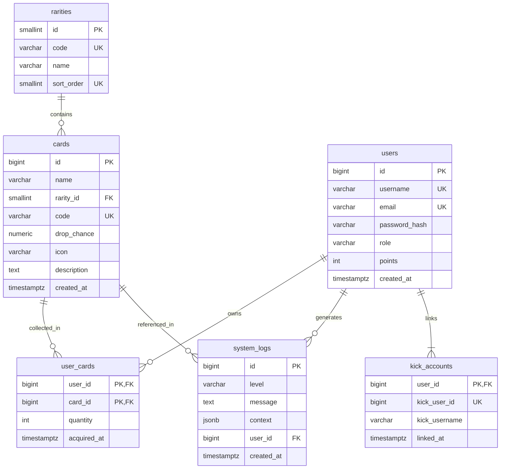

# StreamRip

A collectible card catalog for stream viewers — cards drop while you watch a
live broadcast, and viewers build their collection and compete on the leaderboard.

## Features

| Area | What it does |
|---|---|
| Home | Stream banner, live stats and a card catalog with rarity filters |
| Card catalog | All cards (`/cards`) and card details (`/cards/{id}`) |
| Profile | Collection stats and owned cards (requires login); avatar upload and promo code forms have no POST routes yet |
| Leaderboard | Podium and the full collector ranking |
| Admin panel | Card list, users and roles, system logs, cleanup schedule (requires `admin` role) |
| Login / register | Login and registration with backend (POST `/login`, POST `/register`), CSRF-protected |
| Kick login | Log in with Kick (OAuth 2.1 + PKCE) and link/unlink Kick account from profile |
| About | Project information and how it works (`/about`) |
| 404 | Consistent error screen for unknown routes and missing cards |

## Tech stack

| Layer | Technology |
|---|---|
| Backend | PHP 8.3 (no framework, custom router and controllers) |
| HTTP server | Nginx + php-fpm |
| Autoload | Composer (PSR-4) |
| Containerization | Docker Compose |
| Database | PostgreSQL (PDO, pdo_pgsql) |

## Quick start

Docker with Docker Compose is required. Create a `.env` file in the project root
(kept out of the repository) and fill in the variables:

```dotenv
APP_PORT=8080
POSTGRES_PORT=5433
POSTGRES_DB=streamrip
POSTGRES_USER=streamrip
POSTGRES_PASSWORD=change-me
MAILPIT_PORT=8025
PGADMIN_PORT=5050
PGADMIN_CONTAINER_NAME=pg-admin
PGADMIN_DEFAULT_EMAIL=admin@example.com
PGADMIN_DEFAULT_PASSWORD=change-me
KICK_CLIENT_ID=your-kick-client-id
KICK_CLIENT_SECRET=your-kick-client-secret
KICK_REDIRECT_URI=http://localhost:8080/auth/kick/callback
```

Then:

```bash
docker compose up --build -d
```

Application: http://localhost:8080 (port follows `APP_PORT`).

Before using Kick login, register a Kick app at https://kick.com/settings/developer and set the redirect URI to `http://localhost:8080/auth/kick/callback` (or your deployment URL). Copy the app's client ID, client secret and redirect URI into `.env` as `KICK_CLIENT_ID`, `KICK_CLIENT_SECRET` and `KICK_REDIRECT_URI`.

After changing `composer.json` or the namespace structure:

```bash
docker compose exec php composer dump-autoload
```

Stop the stack: `docker compose down` (including volume data: `docker compose down -v`).

## Project structure

```
public/index.php              # front controller — the only HTTP entry point
public/css/style.css          # styles (tokens + components)
public/views/*.html.php       # views (full pages)
public/views/partials/*.php   # partials: header, footer, card-list
src/Routing.php               # route registration and dispatch
src/controllers/              # controllers (App\Controller namespace)
src/Model/                    # data models (App\Model namespace)
src/Repository/               # data sources (App\Repository namespace)
src/Database.php              # PDO connection factory
src/Session.php               # native PHP session management (start, login, logout, CSRF, Kick OAuth state)
src/Service/                  # external service clients
src/Service/KickClient.php    # Kick OAuth 2.1 client (authorize URL, token exchange, current user)
src/Repository/               # data sources (App\Repository namespace)
src/Repository/KickAccountRepository.php   # kick_accounts table access
database/                     # numbered SQL scripts (schema, views, seed data)
database/04-kick-accounts.sql # kick_accounts table
docker/                       # nginx, php and db configuration
```

## Architecture overview

Flow: **nginx → `public/index.php` → `Routing::dispatch()` → controller → view**.

- Routes are registered only in `public/index.php`:

  ```php
  $routing->get('/about', AboutController::class, 'index');
  ```

- A controller extends `App\Controller\AppController`, is `final`, and its action
  returns `void` and passes data through `render()`:

  ```php
  $this->render('about', ['pageTitle' => 'About – StreamRip']);
  ```

- Array keys become variables inside the view. Partials are rendered with
  `$this->partial('header', ['pageTitle' => $pageTitle])`.
- Every value coming from data is escaped with `htmlspecialchars(...)`.
- Route parameters use the `{id}` syntax (only numeric values are supported).
- Unknown route → `404` and `DefaultController::notFound()`.

## Routing

| Method | Path | Access | Action |
|---|---|---|---|
| GET | `/` | public | `DefaultController::index` |
| GET | `/about` | public | `AboutController::index` |
| GET | `/cards` | public | `CardController::index` |
| GET | `/cards/{id}` | public | `CardController::show` |
| GET | `/profile` | logged in | `ProfileController::index` |
| GET | `/leaderboard` | public | `LeaderboardController::index` |
| GET | `/login` | public | `SecurityController::login` |
| POST | `/login` | public | `SecurityController::loginSubmit` |
| GET | `/register` | public | `SecurityController::register` |
| POST | `/register` | public | `SecurityController::registerSubmit` |
| GET | `/admin` | admin | `AdminController::index` |
| GET | `/overlay` | public | `OverlayController::index` |
| POST | `/logout` | logged in | `SecurityController::logout` |
| GET | `/auth/kick/login` | public | `KickController::login` |
| GET | `/auth/kick/callback` | public | `KickController::callback` |
| GET | `/profile/kick/connect` | logged in | `KickController::connect` |
| POST | `/profile/kick/unlink` | logged in | `KickController::unlink` |

## Project status

The project is under active development. Known placeholders:

- **Profile forms** — the avatar upload and promo code forms on `/profile` have no POST routes yet (they render but cannot be submitted).
- **Role change in admin panel** — the admin panel lists roles (`viewer`, `admin`) but changing a user's role has no POST route yet.
- **Shared layout** — views are rendered inside `public/views/layout.html.php`, which includes the `header` and `footer` partials. Views do not call them directly.
- **Numeric route parameters only** (`\d+`).
- The `src/controllers` directory deviates from PSR-4 (`src/Controller`); it works through a mapping in `composer.json`, and renaming is planned.

## Authentication and roles

### Sessions

- Sessions are native PHP, started exclusively through `App\Session` (`src/Session.php`). `session_start()` is not called anywhere else.
- Session cookie settings: `HttpOnly`, `SameSite=Lax`, `Secure` when the request goes over HTTPS, `session.use_strict_mode=1`, `session.use_only_cookies=1`.
- The session stores only `user_id` (int) and the CSRF token. The user's role and other data are read from the database on every request through `App\Repository\UserRepository`. Role or id coming from POST, GET, cookie, or headers are never trusted.
- After successful login: `session_regenerate_id(true)`. Logout: clears `$_SESSION`, calls `session_destroy()`, and expires the session cookie.
- Protected pages send `Cache-Control: no-store`.

### Passwords

- Passwords are hashed exclusively with `password_hash(..., PASSWORD_DEFAULT)` and verified with `password_verify()`.
- Failed login returns the same generic message regardless of whether the e-mail exists.

### CSRF

- Every POST route requires a valid CSRF token (hidden field `csrf_token`, compared with `hash_equals`). Logout is a POST route.

### Roles

- Two roles exist: `viewer` and `admin`. They are stored in the `users.role` column (`VARCHAR(20)`) with a `CHECK` constraint allowing only `viewer` or `admin`.
- `viewer` can access `/profile` and public pages. `admin` can additionally access `/admin`.
- Role is read from the database on every request, never from the session or request parameters.

### Demonstration accounts (seed data)

All seed users share the developer-only password `StreamRip123!`. This password is for local development only and must not be used in production.

| Username | E-mail | Role |
|---|---|---|
| `ClipMaster` | `ClipMaster@example.com` | viewer |
| `HypeConductor` | `HypeConductor@example.com` | viewer |
| `LurkerLarry99` | `LurkerLarry99@example.com` | viewer |
| `EmoteGoblin` | `EmoteGoblin@example.com` | viewer |
| `RageQuitRhino` | `RageQuitRhino@example.com` | viewer |
| `StreamerBoss` | `StreamerBoss@example.com` | admin |
| `ViewerOne` | `ViewerOne@example.com` | viewer |
| `ModMaria` | `ModMaria@example.com` | viewer |

### How to verify

| User | `/profile` | `/admin` |
|---|---|---|
| Not logged in | 302 redirect to `/login` | 302 redirect to `/login` |
| Viewer | 200 | 403 |
| Admin | 200 | 200 |

## Kick login

Kick is used only for logging in and linking to an existing StreamRip account. There is no registration directly through Kick, and a Kick account without a link cannot log in.

### OAuth 2.1 with PKCE

- `GET /auth/kick/login` starts the flow. The controller generates `state` and `code_verifier` from `random_bytes`, computes `code_challenge` (SHA-256, base64url), stores them in the session with purpose `login`, and redirects to `https://id.kick.com/oauth/authorize` with `response_type=code`, `scope=user:read`, `code_challenge`, `code_challenge_method=S256` and `state`.
- `GET /profile/kick/connect` (requires login) does the same with purpose `link` and the current user's id stored in the session.
- `GET /auth/kick/callback` receives the authorization code. The stored `state` is consumed once and compared with `hash_equals`; a missing, expired or mismatched `state` aborts the flow with a generic error. The code is exchanged for an access token via `POST /oauth/token`, then the current Kick user is fetched from `GET /public/v1/users` (scope `user:read`).
- Access tokens are never stored. From the API response only `kick_user_id` and `kick_username` are saved.

### Linking rules

- Login (`purpose=login`): the Kick user id is looked up in `kick_accounts`. If a link exists, the linked StreamRip user is logged in (`Session::login`, which regenerates the session id). If no link exists, the user is shown an error and redirected to `/login`.
- Link (`purpose=link`): requires the session user to match the user id stored in the OAuth state. A new row is inserted into `kick_accounts`. If the Kick account is already linked to another StreamRip account (unique violation `23505`), an error is shown. On success an `info` entry is written to `system_logs` with the user id.
- `POST /profile/kick/unlink` (requires login + CSRF) deletes the link and writes an `info` entry to `system_logs`.

### Database table

`kick_accounts` stores the link between a StreamRip user and a Kick account:

| Column | Type | Notes |
|---|---|---|
| `user_id` | `BIGINT` | PK, references `users.id` ON DELETE CASCADE |
| `kick_user_id` | `BIGINT` | NOT NULL, UNIQUE |
| `kick_username` | `VARCHAR(100)` | NOT NULL |
| `linked_at` | `TIMESTAMPTZ` | NOT NULL, default `CURRENT_TIMESTAMP` |

The foreign key uses `ON DELETE CASCADE`: when a StreamRip user is deleted, their Kick link is removed automatically. The `user_id` primary key enforces at most one link per user (1:0..1 relationship).

### What is not shown

Kick points / balance are not available through the public API used here, so they are not fetched or displayed.


### Entity-relationship diagram



### Foreign keys

| Foreign key | Target | On delete | Justification |
|---|---|---|---|
| `user_cards.user_id` → `users.id` | `users` | `CASCADE` | A collection entry makes no sense without its owner. |
| `user_cards.card_id` → `cards.id` | `cards` | `RESTRICT` | A card cannot be removed while a user still owns it. |
| `cards.rarity_id` → `rarities.id` | `rarities` | `RESTRICT` | A rarity is a dictionary value; it cannot be deleted while cards reference it. |
| `system_logs.user_id` → `users.id` | `users` | `SET NULL` | Event history must survive user deletion; the user reference becomes NULL. |
| `kick_accounts.user_id` → `users.id` | `users` | `CASCADE` | Removing a StreamRip user also removes their Kick link. |

`ON UPDATE` is the default (no action) everywhere because primary keys are `GENERATED ALWAYS AS IDENTITY` and never change.

### `leaderboard_view`

Defined in `database/02-views.sql`. Aggregates each user's total card quantity, unique card count, join date, and rarest card (highest rarity sort order, lowest card id on ties), and assigns a `RANK()` position ordered by total cards descending, then unique cards descending. Used by `LeaderboardController` via `LeaderboardRepository::all()` on the `/leaderboard` route. The view intentionally has no `ORDER BY`; sorting is applied by the repository query.

### Route → repository method → SQL

| Route | Controller action | Repository method | SQL query |
|---|---|---|---|
| `GET /` | `DefaultController::index` | `CardRepository::all()` | `SELECT c.id, c.name, c.code, c.drop_chance, c.icon, c.description, c.created_at, r.code AS rarity_code, r.name AS rarity_name FROM cards c JOIN rarities r ON r.id = c.rarity_id ORDER BY c.id` |
| `GET /` | `DefaultController::index` | `RarityRepository::all()` | `SELECT id, code, name, sort_order FROM rarities ORDER BY sort_order` |
| `GET /cards` | `CardController::index` | `CardRepository::all()` | Same card query as above |
| `GET /cards/{id}` | `CardController::show` | `CardRepository::find(int)` | Same card query with `WHERE c.id = :id` (named parameter) |
| `GET /leaderboard` | `LeaderboardController::index` | `LeaderboardRepository::all()` | `SELECT user_id, username, total_cards, unique_cards, rank_position, joined_at, rarest_card_name FROM leaderboard_view ORDER BY rank_position, username` |
| `GET /admin` | `AdminController::index` | `CardRepository::all()` | Card query (JOIN rarities) |
| `GET /admin` | `AdminController::index` | `UserRepository::all()` | `SELECT id, username, email, role, points, created_at FROM users ORDER BY id` |
| `GET /admin` | `AdminController::index` | `LogRepository::latest(50)` | `SELECT l.id, l.level, l.message, u.username, l.created_at FROM system_logs l LEFT JOIN users u ON u.id = l.user_id ORDER BY l.created_at DESC, l.id DESC LIMIT :limit` |
| `GET /admin` | `AdminController::index` | `RarityRepository::all()` | Rarity query |
| Error 500 | `public/index.php` catch | `LogRepository::add()` | `INSERT INTO system_logs (level, message, context, user_id) VALUES (:level, :message, CAST(:context AS JSONB), :user_id)` |

### Configuration

Database connection parameters are passed exclusively through environment variables, never hardcoded:

- `.env` defines `POSTGRES_DB`, `POSTGRES_USER`, `POSTGRES_PASSWORD` (and `POSTGRES_PORT` for the host mapping).
- The `php` service in `docker-compose.yaml` maps them to `DB_NAME`, `DB_USER`, `DB_PASSWORD`, and adds `DB_HOST: db` and `DB_PORT: 5432` (the internal container port).
- `App\Database::connect()` reads all five via `getenv()` and builds the PDO DSN `pgsql:host=%s;port=%d;dbname=%s`.

### Seed data and database reset

The schema (`database/01-schema.sql`), view (`database/02-views.sql`) and seed data (`database/03-seed.sql`) are mounted into the db container at `/docker-entrypoint-initdb.d` and run only on an empty volume. To reset everything:

```bash
docker compose down -v
docker compose up --build -d
```

All seed users share the developer-only password `StreamRip123!` (hashed once with `password_hash()`). This password is for local development only and must not be used in production.

## Verification

There is no test framework or configured linter. Before committing:

1. Run `php -l <file>` on changed files (locally or inside the container).
2. Run `composer dump-autoload` after autoload/namespace changes.
3. Manually test the touched routes at http://localhost:8080.

## Development guidelines

- One branch per feature; small, logical commits (Conventional Commits).
- Never commit secrets — configuration lives only in `.env`.
- AI agent rules and code conventions: [`AGENTS.md`](AGENTS.md).

## Authors

- Gabriela Pater
