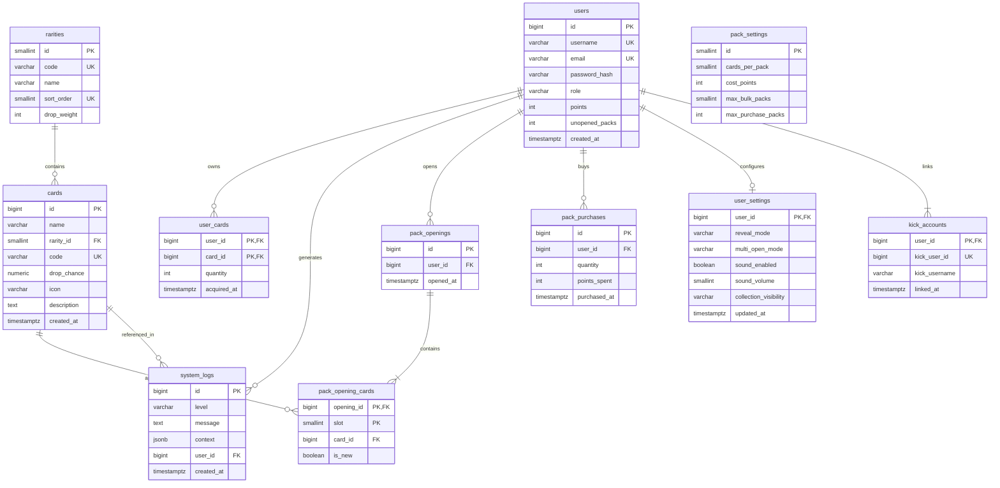

# StreamRip

A collectible card catalog for stream viewers — cards drop while you watch a
live broadcast, and viewers build their collection and compete on the leaderboard.

## Features

| Area | What it does |
|---|---|
| Home | Stream banner, live stats and a card catalog with rarity filters |
| Card catalog | All cards (`/cards`) and card details (`/cards/{id}`) |
| Profile | Collection stats, owned cards and pack wallet (requires login); the promo code form has no POST route yet |
| Public profile | Player card and, when visible, the collection at `/users/{id}` |
| Account settings | Change password, upload or remove an avatar and manage the Kick connection from `/settings/account` (login, JSON envelope, CSRF on POST) |
| Packs | Buy packs and open them from stock (`/packs`, requires login). Buying and opening are separate transactions; results are stored per user |
| Pack opening result | Read-only opening view (`/packs/{id}`, owner only) with revealed cards, NEW markers, rarity glow and the opening date |
| JSON API | `/api/packs/buy`, `/api/packs/open`, `/api/settings/packs`, `/api/settings/privacy`, `/api/settings/password`, `/api/settings/avatar`, `/api/settings/avatar/delete`, `/api/settings/kick/disconnect`, `/api/packs/history`, `/api/collection` and `/api/users/{id}/collection` (JSON envelope, CSRF on POST; most routes require login, public collections are readable without one) |
| Leaderboard | Podium and the full collector ranking with avatars, including packs opened per user |
| Admin panel | Card list, users and roles, system logs, cleanup schedule (requires `admin` role) |
| Login / register | Login and registration with backend (POST `/login`, POST `/register`), CSRF-protected |
| Kick login | Log in with Kick (OAuth 2.1 + PKCE) and connect or disconnect Kick from account settings |
| About | Project information and how it works (`/about`) |
| 404 | Consistent error screen for unknown routes and missing cards |

## Tech stack

| Layer | Technology |
|---|---|
| Backend | PHP 8.3 (no framework, custom router and controllers) |
| HTTP server | Nginx + php-fpm |
| Autoload | Composer (PSR-4) |
| Containerization | Docker Compose |
| Database | PostgreSQL (PDO, pdo_pgsql) |
| Public tunnel | ngrok (optional, exposes the app on a static domain) |

## Quick start

Docker with Docker Compose is required. Create a `.env` file in the project root
(kept out of the repository) and fill in the variables:

```dotenv
APP_PORT=8080
APP_ENV=production
APP_DEBUG=false
POSTGRES_PORT=5433
POSTGRES_DB=streamrip
POSTGRES_USER=streamrip
POSTGRES_PASSWORD=change-me
MAILPIT_PORT=8025
PGADMIN_PORT=5050
PGADMIN_CONTAINER_NAME=pg-admin
PGADMIN_DEFAULT_EMAIL=admin@example.com
PGADMIN_DEFAULT_PASSWORD=change-me
KICK_CLIENT_ID=your-kick-client-id
KICK_CLIENT_SECRET=your-kick-client-secret
KICK_REDIRECT_URI=http://localhost:8080/auth/kick/callback
NGROK_AUTHTOKEN=your-ngrok-authtoken
NGROK_DOMAIN=your-static-domain.ngrok-free.dev
```

Then:

```bash
docker compose up --build -d
```

Application: http://localhost:8080 (port follows `APP_PORT`).

### Public access via ngrok

The `ngrok` service in `docker-compose.yaml` tunnels `server:80` to a static
ngrok domain, so the app can be reached from the internet. Set `NGROK_AUTHTOKEN`
and `NGROK_DOMAIN` in `.env`, then start it with:

```bash
docker compose up -d ngrok
```

Setup notes:

- Copy the authtoken from https://dashboard.ngrok.com/get-started/your-authtoken; a
  truncated or invalid token makes the container restart in a loop (`ERR_NGROK_105`).
- Reserve the static domain under **Domains** in the ngrok dashboard (the free plan
  includes one). A domain not claimed by your account will not start.
- The agent uses `--url=${NGROK_DOMAIN}` (`--domain` is deprecated). Free-plan browser
  traffic shows ngrok's "You are about to visit…" interstitial; removing it requires a
  paid plan.
- `NGROK_AUTHTOKEN` and `NGROK_DOMAIN` are not passed to the PHP container; only the
  `ngrok` service reads them.

Exposing the app publicly is paired with these safeguards:

- `APP_ENV=production` and `APP_DEBUG=false` keep debug output off.
- PostgreSQL (`5432`) and Mailpit (`8025`, `1025`) are bound to `127.0.0.1` only, so
  they are not reachable from the local/academic network or the tunnel.
- Nginx denies hidden files (`location ~ /\.(?!well-known).* { deny all; }`), so `.env`
  and `.git` cannot be downloaded.
- Authorization to `/admin` is handled by application sessions and roles; no Basic Auth
  is added at the tunnel level.

Before using Kick login, register a Kick app at https://kick.com/settings/developer and set the redirect URI to `http://localhost:8080/auth/kick/callback` (or your deployment URL). Copy the app's client ID, client secret and redirect URI into `.env` as `KICK_CLIENT_ID`, `KICK_CLIENT_SECRET` and `KICK_REDIRECT_URI`.

After changing `composer.json` or the namespace structure:

```bash
docker compose exec php composer dump-autoload
```

Stop the stack: `docker compose down` (including volume data: `docker compose down -v`).

## Project structure

```
public/index.php              # front controller — the only HTTP entry point
public/css/style.css          # styles (tokens + components)
public/js/                    # ES modules (no build step)
public/js/api.js              # Fetch API client: CSRF header, timeout, JSON envelope mapping
public/js/theme.js            # light/dark theme toggle and password visibility helper
public/js/sound.js            # Web Audio hook (currently a placeholder: configure/play are no-ops)
public/js/packs/              # packs page modules: index, state, buy, open, settings, history, stage, ui, messages
public/views/*.html.php       # views (content fragments inserted into the layout)
public/views/layout.html.php  # shared layout (header, content, footer)
public/views/partials/*.php   # partials: header, footer, card-list
public/uploads/avatars/       # avatar files (ignored by git except .gitkeep)
src/Routing.php               # route registration and dispatch
src/controllers/              # controllers (App\Controller namespace)
src/Model/                    # data models (App\Model namespace)
src/Database.php              # PDO connection factory
src/Session.php               # native PHP session management (start, login, logout, CSRF, Kick OAuth state)
src/Service/                  # external service clients
src/Service/KickClient.php    # Kick OAuth 2.1 client (authorize URL, token exchange, current user)
src/Repository/               # data sources (App\Repository namespace)
src/Repository/PackRepository.php           # pack buying/opening transactions, openings and history
src/Repository/UserSettingsRepository.php   # per-user pack opening settings
src/Repository/RarityRepository.php         # rarities and drop odds (LEFT JOIN cards)
src/Repository/KickAccountRepository.php    # kick_accounts table access
database/                     # numbered SQL scripts (schema, views, seed data)
database/04-kick-accounts.sql # kick_accounts table
database/05-packs.sql         # pack_settings, pack_openings, pack_opening_cards and rarity drop weights
database/06-leaderboard-packs.sql # leaderboard_view with packs_opened column
database/07-pack-stock-and-settings.sql # users.unopened_packs, pack_purchases, user_settings, is_new
database/08-pack-purchase-limit.sql    # pack_settings.max_purchase_packs
database/09-avatar.sql                 # users.avatar_path
database/10-privacy.sql                # user_settings.collection_visibility
docker/                       # nginx, php and db configuration
```

## Architecture overview

Flow: **nginx → `public/index.php` → `Routing::dispatch()` → controller → view**.

- Routes are registered only in `public/index.php`:

  ```php
  $routing->get('/about', AboutController::class, 'index');
  ```

- A controller extends `App\Controller\AppController`, is `final`, and its action
  returns `void` and passes data through `render()`:

  ```php
  $this->render('about', ['pageTitle' => 'About – StreamRip']);
  ```

- Array keys become variables inside the view. Partials are rendered with
  `$this->partial('header', ['pageTitle' => $pageTitle])`.
- Every value coming from data is escaped with `htmlspecialchars(...)`.
- Route parameters use the `{id}` syntax (only numeric values are supported).
- Unknown route → `404` and `DefaultController::notFound()`.

## Routing

| Method | Path | Access | Action |
|---|---|---|---|
| GET | `/` | public | `DefaultController::index` |
| GET | `/about` | public | `AboutController::index` |
| GET | `/cards` | public | `CardController::index` |
| GET | `/cards/{id}` | public | `CardController::show` |
| GET | `/profile` | logged in | `ProfileController::index` |
| GET | `/leaderboard` | public | `LeaderboardController::index` |
| GET | `/users/{id}` | public | `UserProfileController::show` |
| GET | `/login` | public | `SecurityController::login` |
| POST | `/login` | public | `SecurityController::loginSubmit` |
| GET | `/register` | public | `SecurityController::register` |
| POST | `/register` | public | `SecurityController::registerSubmit` |
| GET | `/admin` | admin | `AdminController::index` |
| POST | `/admin/users/{id}/points` | admin | `AdminController::grantPoints` |
| GET | `/overlay` | public | `OverlayController::index` |
| POST | `/logout` | logged in | `SecurityController::logout` |
| GET | `/packs` | logged in | `PackController::index` |
| GET | `/packs/{id}` | logged in (owner only) | `PackController::show` |
| GET | `/settings` | logged in | `SettingsController::index` (redirects to `/settings/account`) |
| GET | `/settings/account` | logged in | `SettingsController::account` |
| GET | `/settings/packs` | logged in | `SettingsController::packs` |
| GET | `/settings/privacy` | logged in | `SettingsController::privacy` |
| GET | `/settings/performance` | logged in | `SettingsController::performance` |
| GET | `/auth/kick/login` | public | `KickController::login` |
| GET | `/auth/kick/callback` | public | `KickController::callback` |
| GET | `/profile/kick/connect` | logged in | `KickController::connect` |

### JSON API

Every `/api/...` route answers JSON only (`Cache-Control: no-store`), never redirects,
and the Post/Redirect/Get rule does not apply. Most routes require login, checked
before the body is read; `GET /api/users/{id}/collection` is public when the target
collection is public. POST routes also require the `X-CSRF-Token` header.

| Method | Path | Access | Action | Status codes |
|---|---|---|---|---|
| `POST` | `/api/packs/buy` | logged in + CSRF | `PackApiController::buy` | 200, 400 `invalid_json`, 401 `unauthenticated`, 403 `csrf_failed`, 409 `insufficient_points`, 422 `validation_failed` / `invalid_quantity`, 500 `internal_error` |
| `POST` | `/api/packs/open` | logged in + CSRF | `PackApiController::open` | 200, 400 `invalid_json`, 401 `unauthenticated`, 403 `csrf_failed`, 409 `no_unopened_packs`, 422 `validation_failed` / `invalid_quantity`, 500 `internal_error` |
| `POST` | `/api/settings/packs` | logged in + CSRF | `PackApiController::saveSettings` | 200, 400 `invalid_json`, 401 `unauthenticated`, 403 `csrf_failed`, 422 `validation_failed`, 500 `internal_error` |
| `GET` | `/api/settings/privacy` | logged in | `AccountApiController::getPrivacy` | 200, 401 `unauthenticated`, 500 `internal_error` |
| `POST` | `/api/settings/privacy` | logged in + CSRF | `AccountApiController::savePrivacy` | 200, 400 `invalid_json`, 401 `unauthenticated`, 403 `csrf_failed`, 422 `validation_failed`, 500 `internal_error` |
| `POST` | `/api/settings/password` | logged in + CSRF | `AccountApiController::changePassword` | 200, 400 `invalid_json`, 401 `unauthenticated`, 403 `csrf_failed`, 422 `validation_failed`, 500 `internal_error` |
| `POST` | `/api/settings/avatar` | logged in + CSRF | `AccountApiController::uploadAvatar` | 200, 401 `unauthenticated`, 403 `csrf_failed`, 422 `avatar_missing` / `avatar_invalid_type` / `avatar_too_large` / `avatar_invalid_image` / `avatar_dimensions_too_large` / `avatar_upload_failed` / `avatar_processing_failed`, 500 `internal_error` |
| `POST` | `/api/settings/avatar/delete` | logged in + CSRF | `AccountApiController::deleteAvatar` | 200, 401 `unauthenticated`, 403 `csrf_failed`, 409 `avatar_not_found`, 500 `internal_error` |
| `POST` | `/api/settings/kick/disconnect` | logged in + CSRF | `AccountApiController::disconnectKick` | 200, 401 `unauthenticated`, 403 `csrf_failed`, 409 `kick_not_connected` / `password_required`, 500 `internal_error` |
| `GET` | `/api/packs/history?offset=&limit=` | logged in | `PackApiController::history` | 200, 401 `unauthenticated`, 422 `validation_failed`, 500 `internal_error` |
| `GET` | `/api/collection?rarity=&q=&sort=&offset=` | logged in | `CollectionApiController::collection` | 200, 401 `unauthenticated`, 422 `validation_failed`, 500 `internal_error` |
| `GET` | `/api/users/{id}/collection?rarity=&q=&sort=&offset=` | public collection, or owner/admin when private | `CollectionApiController::userCollection` | 200, 403 `forbidden`, 404 `not_found`, 422 `validation_failed`, 500 `internal_error` |

`GET /api/users/{id}/collection` returns the same payload as `/api/collection` plus
`data.owner` (`id`, `username`). Access checks run in order: missing user `404`,
private collection `403`, then filter validation `422`. Private collections are
visible to the owner and admins; public collections need no session.

## Project status

The project is under active development. Known placeholders:

- **Profile form** — the promo code form still renders but has no POST route (`/profile/redeem`). Avatar upload lives in `/settings/account`. Packs are bought and opened on `/packs`.
- **Role change in admin panel** — the admin panel lists roles (`viewer`, `admin`) but changing a user's role has no POST route yet.
- **Shared layout** — views are rendered inside `public/views/layout.html.php`, which includes the `header` and `footer` partials. Views do not call them directly.
- **Numeric route parameters only** (`\d+`).
- The `src/controllers` directory deviates from PSR-4 (`src/Controller`); it works through a mapping in `composer.json`, and renaming is planned.

## Authentication and roles

### Sessions

- Sessions are native PHP, started exclusively through `App\Session` (`src/Session.php`). `session_start()` is not called anywhere else.
- Session cookie settings: `HttpOnly`, `SameSite=Lax`, `Secure` when the request goes over HTTPS, `session.use_strict_mode=1`, `session.use_only_cookies=1`.
- The session stores only `user_id` (int) and the CSRF token. The user's role and other data are read from the database on every request through `App\Repository\UserRepository`. Role or id coming from POST, GET, cookie, or headers are never trusted.
- After successful login: `session_regenerate_id(true)`. Logout: clears `$_SESSION`, calls `session_destroy()`, and expires the session cookie.
- Protected pages send `Cache-Control: no-store`.

### Passwords

- Passwords are hashed exclusively with `password_hash(..., PASSWORD_DEFAULT)` and verified with `password_verify()`.
- Failed login returns the same generic message regardless of whether the e-mail exists.
- Changing a password on `/settings/account` requires the current password, a new password of at least 8 characters, and a matching confirmation; on success the session id is regenerated, other devices stay logged in, and an `info` entry is written to `system_logs` without any password or hash.

### CSRF

- Every POST route requires a valid CSRF token (hidden field `csrf_token`, compared with `hash_equals`). Logout is a POST route.

### Roles

- Two roles exist: `viewer` and `admin`. They are stored in the `users.role` column (`VARCHAR(20)`) with a `CHECK` constraint allowing only `viewer` or `admin`.
- `viewer` can access `/profile` and public pages. `admin` can additionally access `/admin`.
- Role is read from the database on every request, never from the session or request parameters.

### Demonstration accounts (seed data)

All seed users share the developer-only password `StreamRip123!`. This password is for local development only and must not be used in production.

| Username | E-mail | Role |
|---|---|---|
| `ClipMaster` | `ClipMaster@example.com` | viewer |
| `HypeConductor` | `HypeConductor@example.com` | viewer |
| `LurkerLarry99` | `LurkerLarry99@example.com` | viewer |
| `EmoteGoblin` | `EmoteGoblin@example.com` | viewer |
| `RageQuitRhino` | `RageQuitRhino@example.com` | viewer |
| `StreamerBoss` | `StreamerBoss@example.com` | admin |
| `ViewerOne` | `ViewerOne@example.com` | viewer |
| `ModMaria` | `ModMaria@example.com` | viewer |

### How to verify

| User | `/profile` | `/admin` |
|---|---|---|
| Not logged in | 302 redirect to `/login` | 302 redirect to `/login` |
| Viewer | 200 | 403 |
| Admin | 200 | 200 |

## Kick login

Kick is used only for logging in and linking to an existing StreamRip account. There is no registration directly through Kick, and a Kick account without a link cannot log in.

### OAuth 2.1 with PKCE

- `GET /auth/kick/login` starts the flow. The controller generates `state` and `code_verifier` from `random_bytes`, computes `code_challenge` (SHA-256, base64url), stores them in the session with purpose `login`, and redirects to `https://id.kick.com/oauth/authorize` with `response_type=code`, `scope=user:read`, `code_challenge`, `code_challenge_method=S256` and `state`.
- `GET /profile/kick/connect` (requires login) does the same with purpose `link` and the current user's id stored in the session.
- `GET /auth/kick/callback` receives the authorization code. The stored `state` is consumed once and compared with `hash_equals`; a missing, expired or mismatched `state` aborts the flow with a generic error. The code is exchanged for an access token via `POST /oauth/token`, then the current Kick user is fetched from `GET /public/v1/users` (scope `user:read`).
- Access tokens are never stored. From the API response only `kick_user_id` and `kick_username` are saved.

### Linking rules

- Login (`purpose=login`): the Kick user id is looked up in `kick_accounts`. If a link exists, the linked StreamRip user is logged in (`Session::login`, which regenerates the session id). If no link exists, the user is shown an error and redirected to `/login`.
- Link (`purpose=link`): requires the session user to match the user id stored in the OAuth state. A new row is inserted into `kick_accounts`. If the Kick account is already linked to another StreamRip account (unique violation `23505`), an error is shown. On success an `info` entry is written to `system_logs` with the user id. Success and error flashes redirect back to `/settings/account`.
- `POST /api/settings/kick/disconnect` (requires login + CSRF) deletes the link and writes an `info` entry to `system_logs`. It returns `409 kick_not_connected` when there is no link and `409 password_required` when the account has no password to log in with.

### Database table

`kick_accounts` stores the link between a StreamRip user and a Kick account:

| Column | Type | Notes |
|---|---|---|
| `user_id` | `BIGINT` | PK, references `users.id` ON DELETE CASCADE |
| `kick_user_id` | `BIGINT` | NOT NULL, UNIQUE |
| `kick_username` | `VARCHAR(100)` | NOT NULL |
| `linked_at` | `TIMESTAMPTZ` | NOT NULL, default `CURRENT_TIMESTAMP` |

The foreign key uses `ON DELETE CASCADE`: when a StreamRip user is deleted, their Kick link is removed automatically. The `user_id` primary key enforces at most one link per user (1:0..1 relationship).

### What is not shown

Kick points / balance are not available through the public API used here, so they are not fetched or displayed.


### Pack buying and opening

Packs are bought and opened in separate transactions. Every `\Throwable` triggers
`rollBack()` (if a transaction is still active) and is re-thrown. Business errors are
`\DomainException` values with a stable code in the message: `insufficient_points`,
`no_unopened_packs`, `invalid_quantity`, `user_not_found`, `pack_not_configured`.

#### Buying (`PackRepository::buy()`)

1. `beginTransaction()`.
2. `SELECT points, unopened_packs FROM users WHERE id = :id FOR UPDATE` — locks the user's row; if the user does not exist, throws `user_not_found`.
3. Reads `cards_per_pack`, `cost_points`, `max_bulk_packs` and `max_purchase_packs` from `pack_settings` (`id = 1`); if missing, throws `pack_not_configured`.
4. Rejects a quantity outside `1..max_purchase_packs` with `invalid_quantity`.
5. Computes `total = cost_points * quantity`; if `points < total`, throws `insufficient_points` — nothing is spent and no purchase row is written.
6. `UPDATE users SET points = points - :total, unopened_packs = unopened_packs + :quantity WHERE id = :id`.
7. `INSERT INTO pack_purchases (user_id, quantity, points_spent)`.
8. Writes an `info` entry to `system_logs` on the same connection.
9. `commit()`.

#### Opening (`PackRepository::openFromStock()`)

1. `beginTransaction()`.
2. `SELECT unopened_packs FROM users WHERE id = :id FOR UPDATE`; a missing user throws `user_not_found`.
3. Reads the same `pack_settings` row; rejects a count outside `1..max_bulk_packs` with `invalid_quantity`, and a count above the stock with `no_unopened_packs`.
4. `UPDATE users SET unopened_packs = unopened_packs - :count WHERE id = :id`.
5. Loads the draw pool: rarities with `drop_weight > 0` joined with their cards.
6. For each opened pack: `INSERT INTO pack_openings (user_id) ... RETURNING id`; draws `cards_per_pack` cards; upserts each drawn card into `user_cards ... ON CONFLICT (user_id, card_id) DO UPDATE ... RETURNING quantity`; inserts `pack_opening_cards (opening_id, slot, card_id, is_new)`, where `is_new` is true when the upsert returns quantity `1`.
7. Writes an `info` entry with the opening ids to `system_logs`.
8. `commit()`.

**Why `FOR UPDATE`**: without the row lock, two concurrent requests could both read the same balance or stock, both pass the check, and both deduct — causing an overdraft or negative stock. The lock serializes the check-and-deduct per user. Buying and opening are independent, so buying never draws cards and opening never spends points.

**Randomness**: each card is drawn independently. First the rarity is selected by cumulative weight using `random_int(1, $totalWeight)` (rarities without weight or without cards are skipped); then a card from that rarity is selected with `random_int(0, count($cards) - 1)`. Cards may repeat across packs and within a pack. `rand()`/`mt_rand()` are never used.

**Reading results**: `GET /packs/{id}` loads one opening with its cards and `is_new` flags. Only the owner can see it; a missing or foreign opening returns `404`. The page is read-only: all cards are rendered already revealed, with the same card component, NEW marker and rarity glow as the opening scene.

### Tuning packs

Pack parameters live in the database, not in PHP. Adjust them with SQL:

```sql
-- Change pack cost, cards per pack, bulk open limit and purchase limit
UPDATE pack_settings
SET cards_per_pack = 5, cost_points = 150, max_bulk_packs = 10, max_purchase_packs = 500
WHERE id = 1;

-- Change rarity drop weights (sum should stay 100 for percentage-like distribution)
UPDATE rarities SET drop_weight = 50 WHERE code = 'common';
UPDATE rarities SET drop_weight = 30 WHERE code = 'rare';
UPDATE rarities SET drop_weight = 15 WHERE code = 'epic';
UPDATE rarities SET drop_weight = 5 WHERE code = 'legendary';

-- Make a rarity never drop (weight 0 means it is skipped)
UPDATE rarities SET drop_weight = 0 WHERE code = 'legendary';
```

After changing weights, verify the total: `SELECT code, drop_weight FROM rarities ORDER BY sort_order;`.

### Pack opening settings

Settings are per user in `user_settings` (`user_id` primary key). `UserSettingsRepository::find()` returns the defaults when no row exists (`auto`, `queue`, sound on, volume `70`, visibility `public`); saving is an UPSERT. The defaults in PHP match the column defaults and `CHECK` constraints in the migration files.

| Column | Values | Default | Effect |
|---|---|---|---|
| `reveal_mode` | `auto`, `manual` | `auto` | Auto reveals cards one by one; manual lets the viewer click each card in any order |
| `multi_open_mode` | `queue`, `all_at_once` | `queue` | Queue reveals one pack at a time; all-at-once builds every pack on one stage |
| `sound_enabled` | boolean | `true` | Passed to the sound module |
| `sound_volume` | `0..100` | `70` | Passed to the sound module |
| `collection_visibility` | `public`, `private` | `public` | Controls whether other users can see the card list on `/users/{id}` and `/api/users/{id}/collection` |

The pack opening values are managed on the pack opening settings page (`/settings/packs`) and saved through `POST /api/settings/packs`; the opening flow reads them via `GET /api/settings/packs` at the start of `/packs`. The sound module (`public/js/sound.js`) is currently a placeholder whose `configure()` and `play()` functions do nothing, so no audio is synthesized yet even though the settings are stored. The `collection_visibility` value is managed on `/settings/privacy` through `GET` and `POST /api/settings/privacy`, and is enforced by `GET /api/users/{id}/collection`.

The `collection_visibility` column is added by `database/10-privacy.sql`. A fresh database volume applies it automatically; an existing database needs the migration run manually:

```bash
docker compose exec -T db sh -c 'psql -U $POSTGRES_USER -d $POSTGRES_DB' < database/10-privacy.sql
```

On PowerShell:

```powershell
Get-Content database\10-privacy.sql | docker compose exec -T db sh -c 'psql -U $POSTGRES_USER -d $POSTGRES_DB'
```

With `prefers-reduced-motion: reduce`, the CSS disables the reveal/tear transitions and burst animations; in auto mode the stage reveals the remaining cards immediately instead of animating them.

### Fetch API and JSON API

The packs page is rendered by the server; plain ES modules only extend it and there is no build step. Every request goes through `public/js/api.js`:

- `credentials: 'same-origin'`, with `Accept: application/json` and `Content-Type: application/json` headers; `FormData` bodies are sent without setting `Content-Type` so the browser adds the multipart boundary.
- `X-CSRF-Token` copied from `<meta name="csrf-token">` (rendered by the layout only for logged-in users).
- 10-second timeout implemented with `AbortController`.
- The body is parsed as JSON; a non-JSON body, a non-`2xx` status or a missing envelope becomes an `ApiError` with `status`, `code`, `message` and `fields`.

The modules are split by responsibility: `api.js` (transport), `theme.js` (theme toggle), `sound.js` (audio hook), and under `public/js/packs/`: `index.js` (bootstrap), `state.js` (sliders and counters), `buy.js`, `open.js`, `settings.js`, `history.js`, `stage.js` (reveal scene and timers), `ui.js` (busy/status helpers) and `messages.js` (error text). UI always exposes a loading state with `aria-busy`, a success message and an error message.

Response envelope:

```json
{"ok": true, "data": {}}
{"ok": false, "error": {"code": "snake_case", "message": "English text", "fields": {}}}
```

`fields` is present only for `422 validation_failed` (and `invalid_quantity`). Every response carries `Cache-Control: no-store`. Validation is strict: integers must be JSON numbers (not strings), ranges are enforced and unknown fields are rejected.

| Status | `code` | When |
|---|---|---|
| 400 | `invalid_json` | Body is not a JSON object |
| 401 | `unauthenticated` | No valid session (JSON, no redirect) |
| 403 | `csrf_failed` | Missing or invalid `X-CSRF-Token` on a POST |
| 404 | `not_found` | Unknown `/api/...` route |
| 409 | `insufficient_points` | Buying costs more than the current balance |
| 409 | `no_unopened_packs` | Opening more packs than the stock |
| 409 | `kick_not_connected` | Disconnecting Kick when no link exists |
| 409 | `password_required` | Disconnecting Kick when the account has no password to log in with |
| 422 | `validation_failed` | Missing/invalid fields or unknown fields |
| 422 | `invalid_quantity` | Quantity outside `1..max_purchase_packs` or `1..max_bulk_packs` |
| 500 | `internal_error` | Uncaught server exception (details go to `system_logs`) |

Example request and response:

```http
POST /api/packs/buy
Content-Type: application/json
X-CSRF-Token: <token from <meta name="csrf-token">>

{"quantity": 3}
```

```json
{
  "ok": true,
  "data": {
    "points": 550,
    "unopened_packs": 3,
    "purchased": 3,
    "points_spent": 450
  }
}
```

### Entity-relationship diagram



### Foreign keys

| Foreign key | Target | On delete | Justification |
|---|---|---|---|
| `user_cards.user_id` → `users.id` | `users` | `CASCADE` | A collection entry makes no sense without its owner. |
| `user_cards.card_id` → `cards.id` | `cards` | `RESTRICT` | A card cannot be removed while a user still owns it. |
| `cards.rarity_id` → `rarities.id` | `rarities` | `RESTRICT` | A rarity is a dictionary value; it cannot be deleted while cards reference it. |
| `system_logs.user_id` → `users.id` | `users` | `SET NULL` | Event history must survive user deletion; the user reference becomes NULL. |
| `pack_openings.user_id` → `users.id` | `users` | `CASCADE` | A pack opening record belongs to its opener; removing the user removes their opening history. |
| `pack_purchases.user_id` → `users.id` | `users` | `CASCADE` | A purchase belongs to its buyer; removing the user removes their purchase history. |
| `user_settings.user_id` → `users.id` | `users` | `CASCADE` | Opening settings only make sense for an existing user. |
| `pack_opening_cards.opening_id` → `pack_openings.id` | `pack_openings` | `CASCADE` | Opening cards make no sense without the opening record they came from. |
| `pack_opening_cards.card_id` → `cards.id` | `cards` | `RESTRICT` | A card cannot be removed while an opening record references it. |
| `kick_accounts.user_id` → `users.id` | `users` | `CASCADE` | Removing a StreamRip user also removes their Kick link. |

`ON UPDATE` is the default (no action) everywhere because primary keys are `GENERATED ALWAYS AS IDENTITY` and never change.

### `leaderboard_view`

Defined in `database/02-views.sql` and extended by `database/06-leaderboard-packs.sql`. Aggregates each user's total card quantity, unique card count, join date, rarest card (highest rarity sort order, lowest card id on ties), packs opened (correlated count from `pack_openings`), and assigns a `RANK()` position ordered by total cards descending, then unique cards descending. Used by `LeaderboardController` via `LeaderboardRepository::all()` on the `/leaderboard` route. The view intentionally has no `ORDER BY`; sorting is applied by the repository query.

### Route → repository method → SQL

| Route | Controller action | Repository method | SQL query |
|---|---|---|---|
| `GET /` | `DefaultController::index` | `CardRepository::all()` | `SELECT c.id, c.name, c.code, c.drop_chance, c.icon, c.description, c.created_at, r.code AS rarity_code, r.name AS rarity_name FROM cards c JOIN rarities r ON r.id = c.rarity_id ORDER BY c.id` |
| `GET /` | `DefaultController::index` | `RarityRepository::all()` | `SELECT id, code, name, sort_order FROM rarities ORDER BY sort_order` |
| `GET /cards` | `CardController::index` | `CardRepository::all()` | Same card query as above |
| `GET /cards/{id}` | `CardController::show` | `CardRepository::find(int)` | Same card query with `WHERE c.id = :id` (named parameter) |
| `GET /leaderboard` | `LeaderboardController::index` | `LeaderboardRepository::all()` | `SELECT user_id, username, total_cards, unique_cards, rank_position, joined_at, rarest_card_name FROM leaderboard_view ORDER BY rank_position, username` |
| `GET /admin` | `AdminController::index` | `CardRepository::all()` | Card query (JOIN rarities) |
| `GET /admin` | `AdminController::index` | `UserRepository::all()` | `SELECT id, username, email, role, points, unopened_packs, avatar_path, created_at FROM users ORDER BY id` |
| `GET /admin` | `AdminController::index` | `LogRepository::latest(50)` | `SELECT l.id, l.level, l.message, u.username, l.created_at FROM system_logs l LEFT JOIN users u ON u.id = l.user_id ORDER BY l.created_at DESC, l.id DESC LIMIT :limit` |
| `GET /admin` | `AdminController::index` | `RarityRepository::all()` | Rarity query |
| Error 500 | `public/index.php` catch | `LogRepository::add()` | `INSERT INTO system_logs (level, message, context, user_id) VALUES (:level, :message, CAST(:context AS JSONB), :user_id)` |
| `GET /packs` | `PackController::index` | `PackRepository::settings()`, `UserSettingsRepository::find(int)`, `RarityRepository::odds()`, `PackRepository::historyByUser(int, int, int)` | `SELECT cards_per_pack, cost_points, max_bulk_packs, max_purchase_packs FROM pack_settings WHERE id = 1`; `SELECT reveal_mode, multi_open_mode, sound_enabled, sound_volume, collection_visibility FROM user_settings WHERE user_id = :user_id`; `SELECT r.code, r.name, r.drop_weight, COUNT(c.id) AS card_count FROM rarities r LEFT JOIN cards c ON c.rarity_id = r.id GROUP BY r.id ORDER BY r.sort_order`; history queries below |
| `GET /packs/{id}` | `PackController::show` | `PackRepository::findOpening(int)`, `RarityRepository::odds()` | `SELECT po.id AS opening_id, po.user_id, po.opened_at, poc.slot, poc.is_new, c..., r.code AS rarity_code, r.name AS rarity_name FROM pack_openings po LEFT JOIN pack_opening_cards poc ON poc.opening_id = po.id LEFT JOIN cards c ON c.id = poc.card_id LEFT JOIN rarities r ON r.id = c.rarity_id WHERE po.id = :id ORDER BY poc.slot`; odds query above |
| `POST /api/packs/buy` | `PackApiController::buy` | `PackRepository::buy(int, int)` | `SELECT points, unopened_packs FROM users WHERE id = :id FOR UPDATE`; `UPDATE users SET points = points - :total, unopened_packs = unopened_packs + :quantity WHERE id = :id`; `INSERT INTO pack_purchases (user_id, quantity, points_spent) VALUES (:user_id, :quantity, :points_spent)`; `LogRepository::add()` |
| `POST /api/packs/open` | `PackApiController::open` | `PackRepository::openFromStock(int, int)`, `PackRepository::findOpeningsByIds(int, array)`, `UserRepository::findById(int)` | `SELECT unopened_packs FROM users WHERE id = :id FOR UPDATE`; `UPDATE users SET unopened_packs = unopened_packs - :count WHERE id = :id`; `INSERT INTO pack_openings (user_id) VALUES (:user_id) RETURNING id`; `INSERT INTO user_cards (user_id, card_id) VALUES (...) ON CONFLICT (user_id, card_id) DO UPDATE SET quantity = user_cards.quantity + 1 RETURNING quantity`; `INSERT INTO pack_opening_cards (opening_id, slot, card_id, is_new) VALUES (...)`; openings query with `po.user_id = :user_id AND po.id IN (...)`; `SELECT id, username, email, role, points, unopened_packs, avatar_path, created_at FROM users WHERE id = :id` |
| `POST /api/settings/packs` | `PackApiController::saveSettings` | `UserSettingsRepository::save(int, UserSettings)` | `INSERT INTO user_settings (user_id, reveal_mode, multi_open_mode, sound_enabled, sound_volume, collection_visibility, updated_at) VALUES (...) ON CONFLICT (user_id) DO UPDATE SET ...` |
| `GET /api/settings/privacy` | `AccountApiController::getPrivacy` | `UserSettingsRepository::find(int)` | `SELECT reveal_mode, multi_open_mode, sound_enabled, sound_volume, collection_visibility FROM user_settings WHERE user_id = :user_id` |
| `POST /api/settings/privacy` | `AccountApiController::savePrivacy` | `UserSettingsRepository::find(int)`, `UserSettingsRepository::saveCollectionVisibility(int, string)`, `LogRepository::add()` | `SELECT ... FROM user_settings WHERE user_id = :user_id`; `INSERT INTO user_settings (user_id, collection_visibility, updated_at) VALUES (...) ON CONFLICT (user_id) DO UPDATE SET ...`; `INSERT INTO system_logs ...` |
| `POST /api/settings/password` | `AccountApiController::changePassword` | `UserRepository::findPasswordHashById(int)`, `UserRepository::updatePasswordHash(int, string)`, `LogRepository::add()` | `SELECT password_hash FROM users WHERE id = :id`; `UPDATE users SET password_hash = :password_hash WHERE id = :id`; `INSERT INTO system_logs ...` |
| `POST /api/settings/avatar` | `AccountApiController::uploadAvatar` | `AvatarProcessor::process(string, int, int)`, `UserRepository::updateAvatarPath(int, ?string)`, `LogRepository::add()` | `UPDATE users SET avatar_path = :avatar_path WHERE id = :id`; `INSERT INTO system_logs ...` |
| `POST /api/settings/avatar/delete` | `AccountApiController::deleteAvatar` | `UserRepository::updateAvatarPath(int, ?string)`, `LogRepository::add()` | `UPDATE users SET avatar_path = :avatar_path WHERE id = :id`; `INSERT INTO system_logs ...` |
| `POST /api/settings/kick/disconnect` | `AccountApiController::disconnectKick` | `KickAccountRepository::findByUserId(int)`, `UserRepository::findPasswordHashById(int)`, `KickAccountRepository::unlink(int)`, `LogRepository::add()` | `SELECT user_id, kick_user_id, kick_username, linked_at FROM kick_accounts WHERE user_id = :user_id`; `SELECT password_hash FROM users WHERE id = :id`; `DELETE FROM kick_accounts WHERE user_id = :user_id`; `INSERT INTO system_logs ...` |
| `GET /api/packs/history` | `PackApiController::history` | `PackRepository::historyByUser(int, int, int)` | `SELECT id FROM pack_openings WHERE user_id = :user_id ORDER BY opened_at DESC, id DESC OFFSET :offset LIMIT :limit`; `SELECT ... FROM pack_openings po LEFT JOIN ... WHERE po.user_id = :user_id AND po.id IN (...) ORDER BY po.id, poc.slot` |
| `GET /api/users/{id}/collection` | `CollectionApiController::userCollection` | `UserRepository::findById(int)`, `UserSettingsRepository::find(int)`, `CollectionRepository::collectionPage(...)`, `CollectionRepository::collectionSummary(int)`, `RarityRepository::all()` | `SELECT id, username, email, role, points, unopened_packs, avatar_path, created_at FROM users WHERE id = :id`; `SELECT reveal_mode, multi_open_mode, sound_enabled, sound_volume, collection_visibility FROM user_settings WHERE user_id = :user_id`; collection page query with `uc.user_id = :user_id`; summary queries; rarity query |
| `POST /admin/users/{id}/points` | `AdminController::grantPoints` | `UserRepository::addPoints(int, int)`, `LogRepository::add()` | `UPDATE users SET points = points + :amount WHERE id = :id`, `INSERT INTO system_logs ...` |

### Configuration

Database connection parameters are passed exclusively through environment variables, never hardcoded:

- `.env` defines `POSTGRES_DB`, `POSTGRES_USER`, `POSTGRES_PASSWORD` (and `POSTGRES_PORT` for the host mapping).
- The `php` service in `docker-compose.yaml` maps them to `DB_NAME`, `DB_USER`, `DB_PASSWORD`, and adds `DB_HOST: db` and `DB_PORT: 5432` (the internal container port).
- `App\Database::connect()` reads all five via `getenv()` and builds the PDO DSN `pgsql:host=%s;port=%d;dbname=%s`.

Other environment variables in `.env`:

- `APP_ENV` and `APP_DEBUG` — set `APP_ENV=production` and `APP_DEBUG=false` for any
  public deployment so PHP never prints errors to the response.
- `NGROK_AUTHTOKEN` and `NGROK_DOMAIN` — read only by the `ngrok` service; see
  [Public access via ngrok](#public-access-via-ngrok).

### Seed data and database reset

The schema (`database/01-schema.sql`), view (`database/02-views.sql`) and seed data (`database/03-seed.sql`) are mounted into the db container at `/docker-entrypoint-initdb.d` and run only on an empty volume. To reset everything:

```bash
docker compose down -v
docker compose up --build -d
```

All seed users share the developer-only password `StreamRip123!` (hashed once with `password_hash()`). This password is for local development only and must not be used in production.

### Avatar storage

The `php` image includes the `gd` extension with JPEG, PNG and WebP support, plus `fileinfo`. Avatar files live in `public/uploads/avatars/` (ignored by git except `.gitkeep`), are served statically by nginx, and PHP files under `/uploads/` are blocked. Avatars are limited to 2 MB in the application; PHP and nginx limits are set higher (512 MB and 3 MB).

The `users.avatar_path` column is added by `database/09-avatar.sql`. A fresh database volume applies it automatically; an existing database needs the migration run manually:

```bash
docker compose exec -T db sh -c 'psql -U $POSTGRES_USER -d $POSTGRES_DB' < database/09-avatar.sql
```

On PowerShell:

```powershell
Get-Content database\09-avatar.sql | docker compose exec -T db sh -c 'psql -U $POSTGRES_USER -d $POSTGRES_DB'
```

## Verification

There is no test framework or configured linter. Before committing:

1. Run `php -l <file>` on changed files (locally or inside the container).
2. Run `composer dump-autoload` after autoload/namespace changes.
3. Manually test the touched routes at http://localhost:8080.

## Development guidelines

- One branch per feature; small, logical commits (Conventional Commits).
- Never commit secrets — configuration lives only in `.env`.
- AI agent rules and code conventions: [`AGENTS.md`](AGENTS.md).

## Authors

- Gabriela Pater
